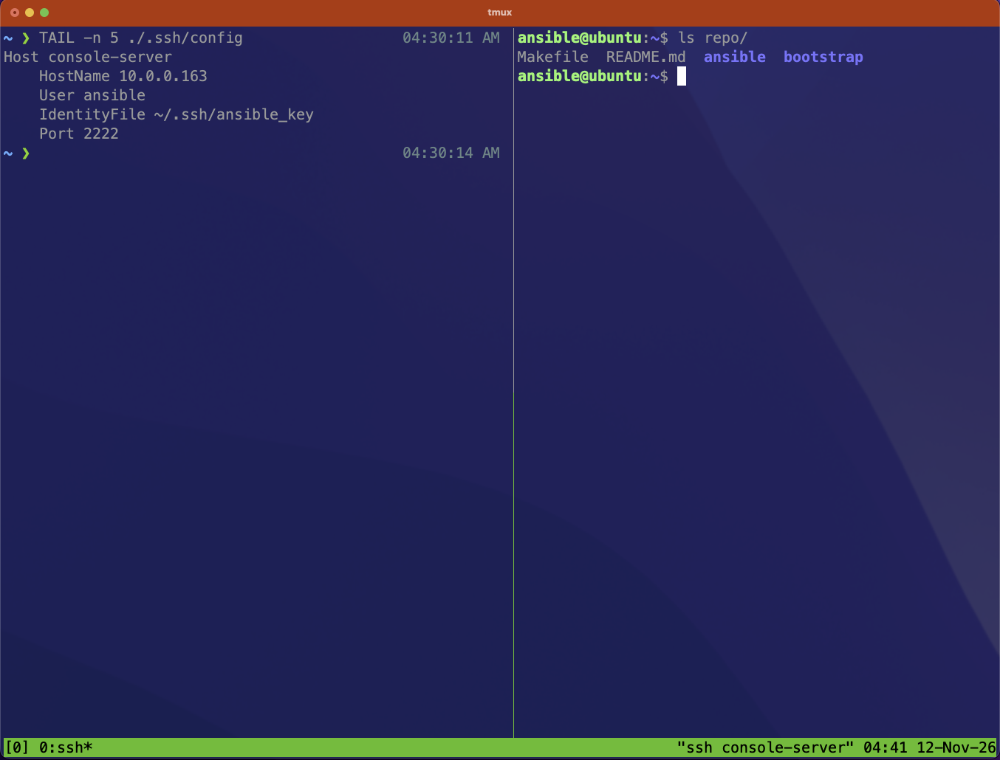
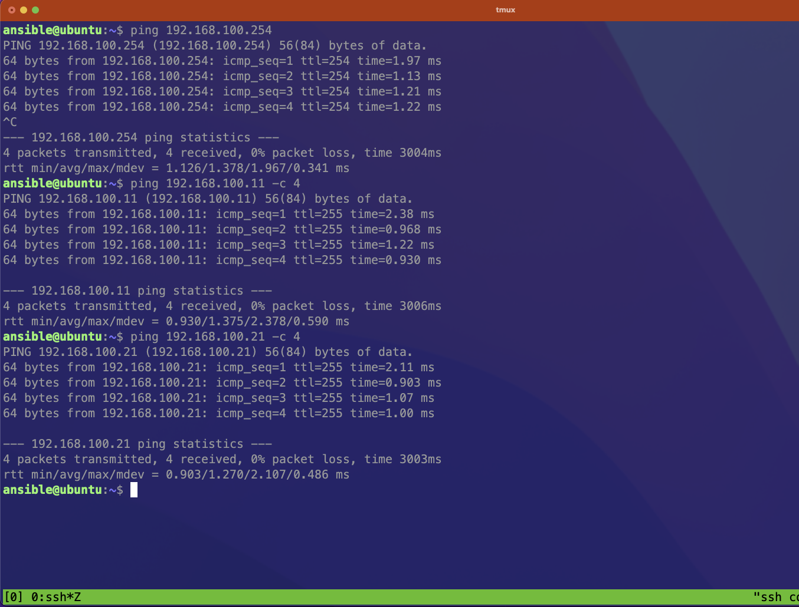

# Network Infrastructure & Out-of-Band Management Lab

## Abstract

A fully automated, virtualized enterprise network environment built using Infrastructure-as-Code (IaC) principles. The architecture features a dual-NIC Ubuntu bastion and console server ensuring secure management access, an isolated out-of-band (OOB) management plane, and integrated core network services hosted via Windows Server workloads.

---

## 🎯 Objectives & Phased Architecture

1. **Bastion Host / WAN Access**: Set up the edge router (R1) to handle WAN connectivity and port forward external SSH traffic (TCP 2222) to the console server's WAN-facing interface (ens4).

2. **OOB Mangagment Plane**: Configure the secondary interface (ens3) on the Ubuntu Console Server to act as the gateway/management headend into the isolated Management Switch, allowing direct access to console ports, device management planes, and downstream infrastructure out-of-band.

3. **Network Services VLAN & Windows Server:** Integrate Windows Server workloads into a dedicated services segment to host core infrastructure roles:
   - **DHCP / DNS:** Automated client address assignment and name resolution.
   - **NTP:** Centralized time synchronization across all network gear and servers.
   - **AAA:** Centralized device authentication and access control.
4. **User VLAN Segmentation:** Implement multi-tier user and device VLANs with inter-VLAN routing controls.
5. **Network Infrastructure Redundancy:** Introduce high-availability topologies, redundant core switching, STP hardening, and gateway failover protocols.

---

## Objective 1: Bastion Host / WAN Access

Configure the gateway router with DHCP WAN interface, NAT overload (PAT) and inbound static port forwarding for extenral ssh access

```bash
[CLOUD]-----[ R1 ]
            |    
            |  
            |  
        [ Console Server ]
```

**Interface Plan**:

| DEVICE | Interface |    IPv4          |    Description
|--------|-----------|------------------|------------
|   R1   | eth 1/3   | ip address DHCP  | nat outside
|   R1   | eth 1/2   | 192.168.200.1/30 | nat inside, OOB link
|   CS*  | ens4      | 192.168.200.2/30 | static ip

*CS: Console Server

**Router Configuration**:

```bash
config t

int eth 1/3
ip address dhcp 
no shutdown 
ip nat outside

int eth 1/2
ip address 192.168.200.1 255.255.255.252
no shutdown
ip nat inside
exit
# PAT 
access-list 1 permit 192.168.200.0 0.0.0.3 
ip nat inside source list 1 interface eth 1/3 
## SSH Fowarded to Console Server
ip nat inside source static tcp 192.168.200.2 22 int eth 1/3 2222
# Route back to Console Server
ip route 192.168.200.0 255.255.255.252 192.168.200.1
```

**Console Server Configuration**:

```bash
sudo -i 
vi /etc/netplan/00-installer-config-.yml
```

```yaml
network:
    ethernets:
        ens4:
            dhcp4: no 
            addresses:
                - 192.168.200.2/30
            routes:  
                - to: default
                  via: 192.168.200.1
            nameservers:
                addresses:
                    - 8.8.8.8
version: 2
```

```bash
netplan try
netplan apply
sudo apt update
sudo apt install -y git
git clone htts://github.com/raulcs16/lab_network_infra.git repo
## Set Up Ansible + SSH Public Key 
cd repo/boostrap
chmod +x ansible.sh
./ansible.sh
```

**Objective Complete**:



## Objective 2.1: OOB Mangagment Plane

Set up paths from Console server to each network device

```bash
[CLOUD]-----[ R1 ]  [ CD1 ]   [ ACC1 ]
            |    |    |          |
            |  [ MANGEMENT SWITCH (MGS) ]
            |        |
        [ Console Server (CS) ]
```

**Interface Plan**:

| DEVICE | Interface    |    IPv4           |    Description
|--------|--------------|-------------------|------------
|   CS   | ens3         | 192.168.100.99/24 |  static ip
|   MGS  | vlan 100     | 192.168.100.1/24  |  SVI
|   MGS  | eth 0/0      |     N/A           |  access port, vlan 100
|   MGS  | eth 1/0      |     N/A           |  trunk, allowed vlan 100
|   MGS  | eth 2/0      |     N/A           |  trunk, allowed vlan 100
|   MGS  | eth 0/1      | 10.1.100.1/31     |  p2p link, no switch port
|   R1   | eth 0/0      | 10.1.100.0/31     |  p2p link
|   R1   | loopback 100 | 192.168.100.254/32|  virtual interface
|   CD1  | eth 0/0      |      N/A          |  trunk, allowed vlan 100
|   CD1  | vlan 100     | 192.168.100.11/24 |  SVI
|   ACC1 | eth 0/0      |       N/A         |  trunk allowed vlan 100
|   ACC1 | vlan 100     | 192.168.100.21/24 |  SVI

**Console Server Configuration**:

```bash
sudo -i 
vi /etc/netplan/00-installer.yaml
```

```yaml
network:
    ethernets:
        ens3:
            dhcp4: no
            addresses:
                - 192.168.100.99/24
        ens4:
            dhcp4: no 
            addresses:
                - 192.168.200.2/30
            routes:  
                - to: default
                  via: 192.168.200.1
            nameservers:
                addresses:
                    - 8.8.8.8
version: 2
```

```bash
netplan try
netplan apply
```

**Mangagment Switch Configuration**:

```bash
config t
vlan 100
name OOB

int vlan 100
ip address 192.168.100.1 255.255.255.0
no shutdown

int eth 0/0
switchport mode access
switchport access vlan 100
spanning-tree portfast
spanning tree bpdugaurd enable
no shutdown

int eth 0/1
no switchport
ip address 10.1.100.1 255.255.255.254
no shutdown
exit
ip routing
ip route 192.168.100.254 255.255.255.255 10.1.100.0

int eth 1/0
switchport trunk encapsulation dot1q
switchport mode trunk
switchport trunk allowed vlan 100
no shutdown

int eth 2/0
switchport trunk encapsulation dot1q
switchport mode trunk
switchport trunk allowed vlan 100
no shutdown
```

**Router Configuration**:

```bash router
config t
int loopback 100
ip address 192.168.100.254 255.255.255.2555
no shutdown

int eth 0/0
ip address 10.1.100.0 255.255.255.254
no shutdown
ip route 192.168.100.0 255.255.255.0 10.1.100.1
```

**CD1 Configuration**:

```bash
config t
vlan 100
name OOB
int vlan 100
ip address 192.168.100.1 255.255.255.0 
no shutdown
int eth 0/0
switchport trunk encapsulation dot1q
switchport mode trunk
switchport trunk allowed vlan 100
no shutdown
```

**ACC1 Configuration**:

```bash
config t
vlan 100
name OOB
int vlan 100
ip address 192.168.100.11 255.255.255.0 

no shutdown
int eth 0/0
switchport trunk encapsulation dot1q
switchport mode trunk
switchport trunk allowed vlan 100
no shutdown
```

**Objective 2.1 Complete**:



## Objective 2.2: Set Up SSH Login on each Device

**device config**:

```bash
config t
ip domain-name netlab.local
crypto generate rsa modulus 2048

line vty 0 15 
transport input ssh
login local
exit
```

```bash
cd ./.ssh
ssh-keygen -t rsa -b 2048
: netlab
```
